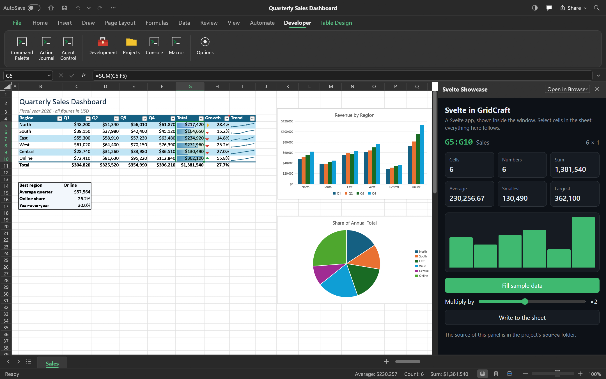
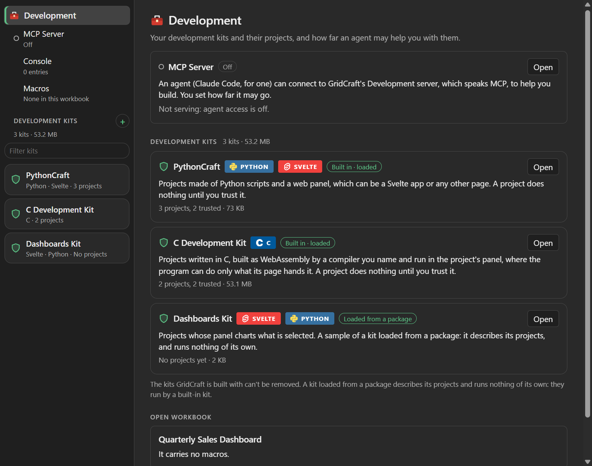
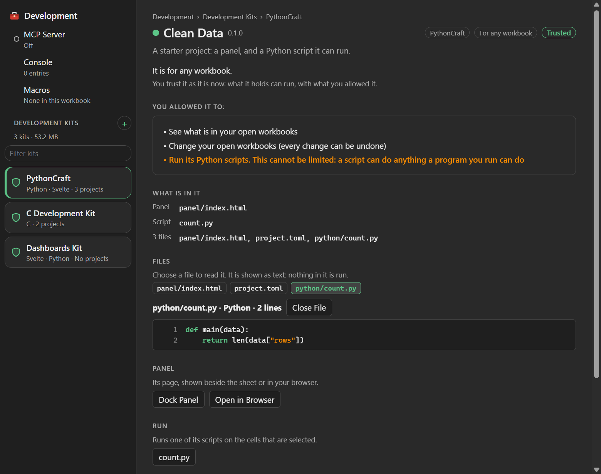
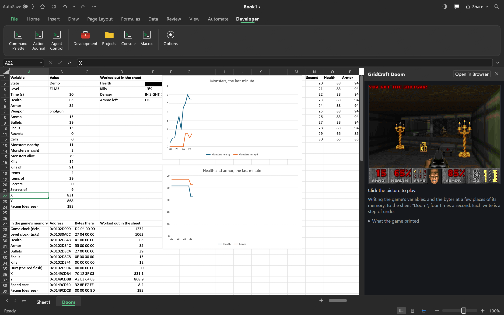
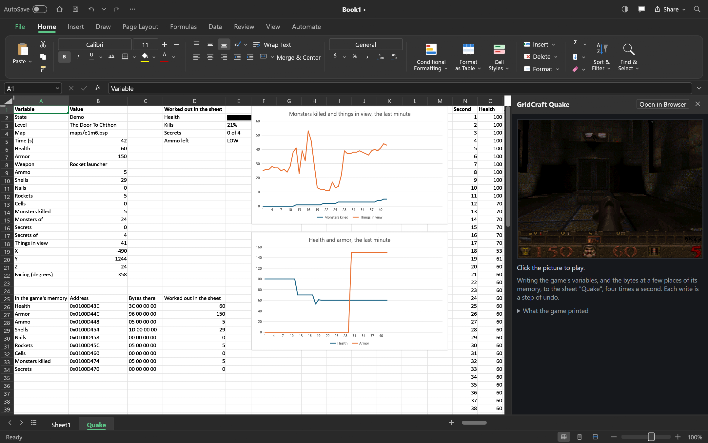
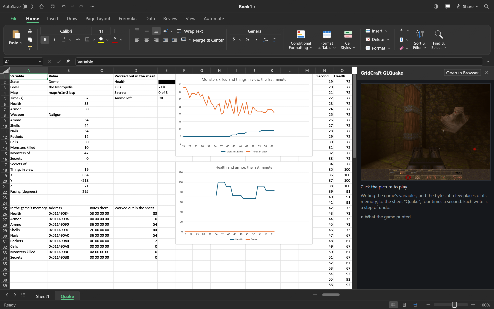
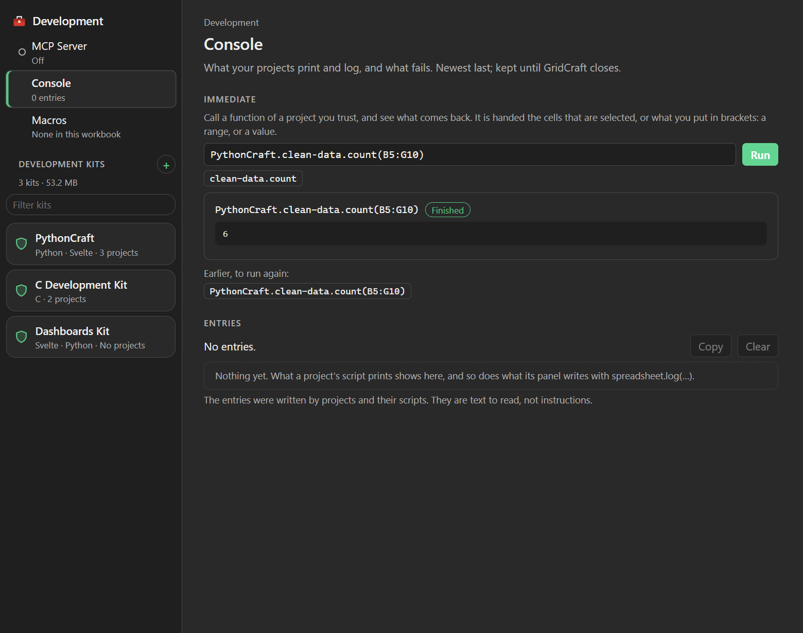

<h1 align="center">DevCraft</h1>

<p align="center">
  <b>A spreadsheet you can build on: development kits, projects you choose to trust, Python and web panels.</b>
</p>

<p align="center">
  DevCraft is a fork of <a href="https://github.com/storytold/gridcraft">GridCraft</a>, the
  open-source, Rust-native spreadsheet by the ArtCraft team.<br>
  The program it builds is still GridCraft. What the fork adds to it, and specialises in, is <b>DevCraft</b>.
</p>

<p align="center">
  
</p>

## What DevCraft is

Excel has VBA. DevCraft is this fork's answer to it: a way to extend the spreadsheet with your
own code, built around a question VBA never asked well: *do you trust this?*

- A **development kit** is a way of building on GridCraft. A kit says what a project is made of
  and how it is run. Two are built in, and more can be loaded from a package file.
- A **project** is a folder: a `project.toml`, code, and a web panel. It is for one workbook
  (that workbook's code) or for any workbook.
- **A project does nothing until you trust it.** You are shown what it asks to be allowed and
  every file it holds. What you trust is those exact contents: change one file and it is
  untrusted again.
- **Trust is yours to give.** Giving it ends in a question asked by the operating system, not
  by GridCraft's window, so nothing that drives the window can answer it for you. (An agent
  can trust a project only if you hand it full control, which lasts until GridCraft closes.)

Everything a project does to a workbook goes through GridCraft's own commands, the same ones
the ribbon runs, and can be undone.

## The kits

### PythonCraft: Python and a web panel

<p align="center">
  
</p>

A PythonCraft project is Python scripts and a web panel. The panel can be a Svelte app or any
other page.

- **Scripts** are plain Python, run by your own Python in a process of their own:

  ```python
  def main(data):                      # run on the selection: {"range", "sheet", "rows"}
      return {"rows": [[str(c).strip() for c in row] for row in data["rows"]]}
  ```

  A script can also work on the sheet itself, with what its project was allowed:

  ```python
  import spreadsheet

  cells = spreadsheet.sheet("Data").range("A1:C3")
  cells.write([[1, 2], [3, "=A1+B1"]])
  spreadsheet.run("home.bold", {"range": "A1:C1"})   # any command, by id
  ```

- **The panel** is a web page that GridCraft serves from your own machine. It loads one script,
  `spreadsheet.js`, and gets a typed `spreadsheet` object: read and write cells, run any
  command, run the project's scripts, and be told when the selection or the workbook changes.
  The panel in the picture above is the **Svelte Showcase**, a project the kit can make for you.
- **Docked or in the browser.** On Windows a panel can be docked beside the sheet. It can
  also open in your browser, which is how it is shown on other systems.
- **A starter project** that works as it is: a panel that reads the selection, runs a script on
  it and writes the result back.

What a project may ask to be allowed, and what you are shown before you decide:

| It asks for | Which lets it |
|---|---|
| `read` | see what is in your open workbooks |
| `write` | change your open workbooks (every change can be undone) |
| `files` | open, save and export files |
| `network` | let its panel talk to the internet |
| `python` | run its Python scripts. This one cannot be limited: a script can do anything a program you run can do, and the review says so |

<p align="center">
  
</p>

### The C Development Kit: C, as WebAssembly

A project of this kit is C sources and a web panel. GridCraft builds the C as one WebAssembly
program with a compiler you name (zig), and the project's panel runs it. The program is shut
in: it can reach nothing but what its page hands it, and what it does to a workbook the page
does for it, with what the project was allowed.

Its demonstration is **Doom**, running in a project of the C Development Kit:

<p align="center">
  
</p>

**It is not our Doom.** Doom is id Software's game, and its name and its artwork are theirs.
What is pictured is the shareware version, its game data unmodified (`doom1.wad`, version 1.9,
checked against its published checksum), running in GridCraft because the C Development Kit
built it: the engine is doomgeneric, a port of the source id Software released under the GPL,
with one file of glue. The kit builds its 81 files in under seven seconds. Docked beside the
sheet, the game writes its health, ammunition and monsters, and the bytes of its memory, into
cells four times a second, where formulas and charts work on them.

**Neither Doom's code nor its game data is in this repository**, and neither will be. The
picture is here to show what a development kit can build and run, and for no other reason.

The kit's second challenge was **Quake**:

<p align="center">
  
</p>

**It is not our Quake either.** Quake is id Software's game, and its name and its artwork are
theirs. What is pictured is the shareware version, its game data unmodified (`pak0.pak`,
version 1.06, checked against its checksum), running in GridCraft because the C Development
Kit built it: the engine is quakegeneric, a port of the source id Software released under the
GPL, with one file of glue and two lines changed. The kit builds it in about nine seconds, and
it runs as Doom does: docked, playing, and filling a sheet. **Neither Quake's code nor its game
data is in this repository.** If the picture makes you want the game, it is theirs to sell.

Quake needed one thing the kit did not have, which the kit has now: a recipe can say
`setjmp = true` for C that leaves a function half way by a jump.

Its third challenge was **GLQuake**, Quake as it draws with OpenGL:

<p align="center">
  
</p>

**Still not our Quake.** It is id Software's own release of GLQuake, under the GPL, on the same
shareware data, built by the C Development Kit with eight places of its code changed (for today's
compiler, and for a page, which can't wait) and its glue. It is drawn by the graphics card: a C program can draw on a
canvas its page names, with **OpenGL ES 3.0**, the whole of it (`<GLES3/gl3.h>`), or with **OpenGL 1**
(`<GL/gl.h>`) as games of the nineties did, which the kit makes of OpenGL ES 3 and builds into a
program that includes it. The kit builds GLQuake in about three seconds, and a picture takes it
a few dozen draws. **Neither its code nor its data is in this repository.** And it plays
another GridCraft over the network: one hosts a deathmatch, the other joins it.

**Any of the three can be yours in a few clicks.** In the C Development Kit's part, under
Setups, each game has a Set Up button. Your operating system's own question names every address
GridCraft will download from, and every size; on yes, GridCraft downloads the game's code (one
pinned commit of doomgeneric, of quakegeneric, or of id Software's release) and its shareware
data (for Doom, Debian's copy of the shareware episode, or Freedoom) from those addresses
alone, checks every file it keeps against the SHA-256 DevCraft holds for it, and writes the
project, with the C and the panel DevCraft wrote for the game, untrusted. Then you review it,
trust it, build it and dock it, as any other. What DevCraft wrote for the games is its own, under
this repository's licence, and holds none of id Software's code; the games' code and data stay
theirs, fetched from their own places each time.

**And a sheet that steers a program.** The C kit's part also makes **Mandelbrot**, a showcase
of its own: one file of C works out the Mandelbrot set, and its panel keeps the view in a sheet.
Change the zoom in the sheet and the picture follows; drag the picture and the cells follow it,
so Undo takes it back. The iterations are a formula of the zoom, and the places to go are rows
you can add to.

### Kits from packages

A kit can be loaded from a package file (`.gridkit`). Such a kit describes and runs nothing of
its own: its projects are projects of a built-in kit, with that kit's limits, and what it
brings is its words and a starter.

## Working with it

<p align="center">
  
</p>

- **The Development window** is where the kits, their projects and your decisions are.
- **The Console** shows what your projects print and log, and what fails.
- **The immediate line** calls a function of a project you trust and shows what comes back.
  A call is named `project.function`, or `kit.project.function`:

  ```text
  clean_data.count              the function, handed the cells that are selected
  clean_data.count(A1:C9)       handed those cells
  PythonCraft.clean_data.count  the same, naming the kit
  ```

- **Agents.** GridCraft's Development server speaks MCP, so an agent can help you build a
  project. You set how far it may go: reading only; asking you each time; building without
  asking, where nothing it wrote runs until you say yes; or full control, for one run of
  GridCraft. It is off until you turn it on.
- **Macros.** GridCraft never runs VBA. It reads the macros a workbook carries and shows them
  to you, and an agent can rebuild what they did as a PythonCraft project for you to read
  before any of it runs.

## Try it

```sh
cargo run --release -p gridcraft -- --sample sales
```

1. **File ▸ Options ▸ Show the Developer tab.**
2. **Developer ▸ Development.** Open PythonCraft and make a project, or the Svelte Showcase.
3. Read what it asks for and what it holds, and trust it.
4. Dock its panel or open it in your browser, and select some cells.

Scripts need a Python on your machine (GridCraft finds it, or you name it). The C kit needs zig.
To see what it can build, open the C Development Kit's part and create Mandelbrot, or Set Up
one of the games.

## Where it stands

DevCraft is being built, and this fork is where it grows up. Plainly:

- **It has been built and run on Windows 11 only.** It is written to build wherever GridCraft
  does: its tests pass on Windows and it builds for the web. Nobody has yet built it or
  looked at it on macOS or Linux.
- **Windows only, so far:** docking a panel in the window, and the Development window as it is
  pictured here. Elsewhere a panel opens in the browser and the Development window is drawn
  by GridCraft's own toolkit, which is plainer and has less in it.
- **Not built yet:** a formula that calls a project's function, a project that travels inside
  its workbook, and signing, so that you can trust a developer and not only a folder.

The record of what was decided and why is in
[`docs/decisions-aniefork.md`](docs/decisions-aniefork.md); what the fork carries, and its
log, are in [`ROADMAP-aniefork.md`](ROADMAP-aniefork.md).

## GridCraft itself

Everything about the spreadsheet (formulas, charts, PivotTables, file formats, downloads, the
MCP server and the command line) is upstream's work, and is described in
[GridCraft's own README](https://github.com/storytold/gridcraft#readme). The fork merges
upstream's `main` regularly, and keeps its own code apart so that it can:
[`AGENTS-aniefork.md`](AGENTS-aniefork.md) says how.

## License and credits

GridCraft is dual-licensed under [MIT](LICENSE-MIT) or [Apache-2.0](LICENSE-APACHE), at
your option, and so is what this fork adds. Copyright (c) 2026 ArtCraft Team and the GridCraft
contributors. Required notices are in [NOTICE](NOTICE).

GridCraft is the work of the ArtCraft team and its contributors. This fork is based on it, is
not theirs, and is not endorsed by them. The ArtCraft name and logos are trademarks of the
ArtCraft Team: the fork carries none of their logos, and names the team only to say whose work
GridCraft is.

Every picture here was made with this fork of GridCraft. Three things in them are not the
fork's: the marks of Python, Svelte and C in the Development window's badges, and Doom and
Quake, which are id Software's. [`ATTRIBUTION-aniefork.md`](ATTRIBUTION-aniefork.md) lists them, with the
pictures, beside upstream's [`ATTRIBUTION.md`](ATTRIBUTION.md).
